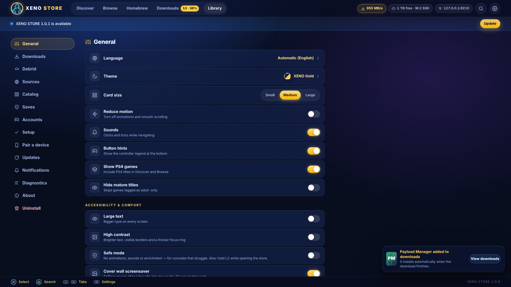

<!-- ╔═══════════════════════════════════════════════════════════════════╗ -->
<!-- ║                XENO STORE — PS5 GAME STORE + DOWNLOADER             ║ -->
<!-- ╚═══════════════════════════════════════════════════════════════════╝ -->

<div align="center">


<br/>


<br/><br/>


[](../../../releases?q=xeno-store&expanded=true)
[](../../../actions/workflows/xeno-store.yml)
[](../../../actions/workflows/xeno-store-catalog-sync.yml)


<br/>

### 🟢 [**⬇️  DOWNLOAD XENO STORE  ⬇️**](../../../releases/latest)

<sub>`xeno-store.elf` · `xeno-store-browser.elf` · `XENO-STORE.zip` (home-screen app) · `SHA256SUMS` · look for the <b>xeno-store-v1.0.0</b> release</sub>

</div>

---

<div align="center">

## 💎 What is XENO STORE?

</div>

> **XENO STORE** is a **native PS5 game store and download manager** that runs
> *on the console itself*. Send one payload, open the store in the PS5 browser
> (or on your phone), pick a game, pick a drive, press ✕. The console downloads it
> with up to **16 parallel connections**, verifies it, **installs the package** or
> drops the image where **ShadowMountPlus** finds it, and keeps going while the
> browser is closed. No PC in the loop. 🔥

<div align="center">

<table>
<tr>
<td align="center">🛒<br/><b>1,965</b><br/><sub>games in the catalog</sub></td>
<td align="center">✅<br/><b>881</b><br/><sub>verified direct releases</sub></td>
<td align="center">⚡<br/><b>16</b><br/><sub>connections per download</sub></td>
<td align="center">💾<br/><b>Saves</b><br/><sub>backup · restore · share</sub></td>
<td align="center">📱<br/><b>Phone</b><br/><sub>pair by QR or xeno.local</sub></td>
</tr>
</table>

</div>

---

## ✨ Features

| | Feature | What you get |
|:--:|:--|:--|
| 🛒 | **One big catalog** | **1,965 PS5 + PS4 games / 2,592 releases** merged from BlackBox, Orbit, Archive.org, dlpsgame, SuperPSX, pkg.games and more, with cover art, screenshots, Metacritic, genres and a **6-hour auto sync** (no app update needed). |
| ⚡ | **Fast downloads** | Segmented transfer with **work-stealing chunks**, per-host adaptive windows, resume with sidecars, mirror failover, **Turbo start** (races mirrors and keeps the fastest), bandwidth limit, schedule window, lifetime stats. |
| 📦 | **PKG auto-install** | Packages install the moment they finish (native AppInstUtil, with DPI / etaHEN DPI fallback). **Install sets**: game → backport → update → DLC, installed in order, one tap. |
| 🧩 | **Images just work** | exFAT / FFPFSC / FFPKG dumps land in `homebrew/` and XENO STORE pokes **ShadowMountPlus** to scan them. ZIP archives are **extracted on the console**. |
| 🔁 | **Backports** | Releases built for lower firmware are tagged with their target firmware; the store offers the right backport for *your* console and lists them in Updates center. |
| 🚀 | **Debrid support** | Connect **Real-Debrid, AllDebrid, TorBox or Premiumize** with your own key and the store unrestricts supported hosts into direct, range-capable links. Keys never leave the console except to the chosen service. |
| 💾 | **Save Data Store** | Community saves for PS5 titles with a **compatibility check** (installed? same region? same version?), one-tap install with automatic pre-backup, and **one-click share** of your own save. |
| 🗄️ | **Saves hub** | Back up any profile's saves to ZIP, restore them, transfer between profiles on the same console, "Back up all saves now". |
| 🏠 | **Homebrew tab** | Apps, emulators and tools listed from pkg-zone with one-tap install and "Update available" badges. |
| 👤 | **Accounts** | Offline account activation (registry slot method), plus NP fake sign-in / sign-out companions for offline trophies. |
| 🧰 | **Companions** | ShadowMountPlus, package installer daemon, kstuff, app dumper, Garlic — downloaded with a hash check and sent to the local ELF loader. **Readiness checklist** tells you what is still missing. |
| 🕹️ | **Couch-grade UI** | DualSense spatial navigation, PS glyph legend, 7 themes, large-text and high-contrast modes, cover-wall screensaver, command palette on desktop, phone layout with bottom tabs. |
| 🌐 | **xeno.local** | Built-in mDNS answers `http://xeno.local:9095` on your Wi-Fi, so phones and laptops find the console without typing an IP. |
| 🧹 | **Clean uninstall** | Settings → Uninstall removes exactly what the store created (and keeps your games). Ghost-icon cleaner for leftover `/data/homebrew` folders. |
| 🔒 | **No accounts, no telemetry** | Local network only. The only outbound traffic is the catalog / feed sync you can turn off, plus the downloads you start. |

---

## 🏁 Why people switch

The scene already has great tools. XENO STORE borrows the best idea from each and goes further —
here is the honest picture, based on their public READMEs when this was written (they move fast; check them too).

| | **XENO STORE** | Orbit Store | BlackBox | Overdrive |
|:--|:--|:--|:--|:--|
| Runs on the console | ✅ one ELF, keeps downloading with the browser closed | ✅ | ✅ | ✅ |
| Catalog | ✅ 1,965 games · 10 sources merged · Archive.org metadata hashes · synced every 6 h | own catalogue | own verified catalog | imports Orbit's catalogue |
| Segmented downloads | ✅ up to 16 connections, work-stealing, adaptive window, Turbo start | queue | queue | ✅ segmented + failover |
| Resume after a crash / rest mode | ✅ sidecar checkpoints, validator re-probe, rest-mode auto-resume | varies | varies | ✅ |
| PKG auto-install | ✅ native + 2 fallbacks, **install sets** in order | — ¹ | — ¹ | — ¹ |
| Backports | ✅ facet, rail, per-firmware pick | — ¹ | — ¹ | — ¹ |
| Debrid (RD / AD / TorBox / Premiumize) | ✅ | — ¹ | — ¹ | — ¹ |
| Save backup / restore / **community saves** | ✅ Saves hub + Save Data Store | — ¹ | — ¹ | — ¹ |
| Homebrew app store | ✅ pkg-zone tab | — ¹ | — ¹ | — ¹ |
| Phone companion | ✅ QR + `xeno.local` | ✅ pairing | — ¹ | — ¹ |
| Controller navigation | ✅ spatial, remappable, legend | ✅ | ✅ | ✅ best-in-class, we learned from it |
| Languages | English now, 13 more wired in | — ¹ | — ¹ | — ¹ |
| Clean uninstall | ✅ | — ¹ | — ¹ | — ¹ |
| License | GPL-3.0 | GPL-3.0 | — | GPL-3.0 |

<sub>¹ not advertised in the project's documentation when we checked — it may exist or be planned. Nothing here is a knock on those projects: see **Credits**.</sub>

---

## 📸 Screenshots

<sub>1920×1080 captures from the real UI (`docs/screenshots/`). Phone captures are 390×844.</sub>

| Discover | Game page | Download options |
|:--:|:--:|:--:|
|  |  |  |

| Downloads | Library | Settings |
|:--:|:--:|:--:|
|  |  |  |

| Save Data Store | Homebrew | Phone |
|:--:|:--:|:--:|
|  |  |  |

---

## 🚀 Install

You need a jailbroken PS5 with an ELF loader listening on **port 9021** (etaHEN, the ps5-payload-dev `elfldr`, XENO TOOL's Payloads tab all do). Then pick **one** of the three ways:

### 1 · Send the ELF (fastest)

```text
1.  ⬇️   Download  xeno-store-browser.elf  from the xeno-store-v1.0.0 release
2.  📡   XENO TOOL → Payloads → Send file  (or any loader on port 9021)
3.  🌐   The PS5 browser opens http://127.0.0.1:9095 by itself
         (sent xeno-store.elf instead? open http://<ps5-ip>:9095 or http://xeno.local:9095)
4.  ✅   First run: pick your sources, pick a default drive, read the readiness checklist
```

### 2 · Home-screen app (etaHEN / itemzflow)

```text
1.  ⬇️   Download  XENO-STORE.zip
2.  📂   Extract it so you get  /data/homebrew/XENO-STORE/eboot.bin  (+ sce_sys/, homebrew.json)
         (XENO TOOL → Files, FTP, or etaHEN's own file manager)
3.  🏠   The XENO icon appears in your homebrew launcher — start it like any app
```

### 3 · Payload Manager (auto-start on every boot)

Add this URL as a **source** in Payload Manager and enable auto-start for **XENO STORE**:

```text
https://raw.githubusercontent.com/XENOKING123/XENOKING/main/xeno-store/updates/payloads.json
```

<sub>Settings → Setup shows the same URL as a QR code. CI fills the sha256 of every release into that file, so Payload Manager verifies what it downloads.</sub>

> 💡 **Updating** is built in: Settings → Updates → *Check* → *Install update* downloads the new ELF, checks its sha256 and stages it; stop the store and send it again (or reboot with Payload Manager auto-start) to run the new version.

---

## ✅ First run & readiness checklist

The welcome sheet asks three things: which **sources** you want to see, which **drive** downloads go to, and a notice you acknowledge once. After that **Settings → Setup** runs a checklist (also available any time):

| Check | Why it matters | Fix offered |
|:--|:--|:--|
| ShadowMountPlus API (`127.0.0.1:10101`) | Mounts exFAT / FFPFSC dumps so they show on the home screen | **Launch ShadowMountPlus now** when a copy is on the console, or install it from Companions |
| Package installer (`:9040`) | Fallback for PKG install when the native call is refused | Install the companion daemon |
| etaHEN DPI (`:12800`) | Optional second fallback | Load etaHEN before the store |
| Internet | Catalog sync, cover art, downloads | Shows the exact host that failed |
| Default drive writable + free space | Nothing starts without room (256 MB reserve + the file) | Pick another drive / Disk analyzer |
| Firmware | PS5 fake packages (FPKG) need a supported firmware — **11.60 or lower as of October 2026** | Explains what still works on newer firmware (images via ShadowMountPlus, homebrew PKGs, saves) |
| Payload Manager | Auto-start on boot | QR + URL of `payloads.json` |

---

## 🎮 Controls

| Button | Action |
|:--:|:--|
| **D-pad / left stick** | Move focus (rails scroll, grids are virtualized) |
| **✕** | Select / Download |
| **○** | Back (also closes sheets and the gallery) |
| **□** | Favorite the focused game |
| **△** | Search |
| **L1 / R1** | Previous / next tab (Discover · Browse · Homebrew · Library · Downloads) |
| **Options** | Settings |
| **L2 held while the store opens** | **Safe mode** — no animations, sounds or online enrichment (also a Settings toggle) |
| **Settings → General → Swap ✕/○** | Japanese layout |

Keyboard (phone / desktop): arrows, Enter, Esc, `F` favorite, `Q`/`E` tabs, `/` search, `?` shortcuts, `Ctrl/Cmd+K` command palette. Mouse and touch work everywhere.

---

## 📂 Formats

| Format | What happens after download | Needs |
|:--|:--|:--|
| **PKG / FPKG** | Saved to `<drive>/xeno-store/pkg/` and **installed automatically** (native → DPI `:9040` → etaHEN DPI `:12800`). Install sets install game → backport → update → DLC in order. | FPKG: firmware ≤ 11.60 + kstuff/etaHEN as of Oct 2026 |
| **exFAT · FFPFSC · FFPKG · FFPFS** | Saved to `<drive>/homebrew/` and ShadowMountPlus is asked to scan. | ShadowMountPlus |
| **ZIP** | Saved to `<drive>/xeno-store/files/` and **extracted on the console** (folder dumps → `homebrew/<name>/`, single images straight to the image file); the archive is deleted after a successful extract (both toggles in Settings). | — |
| **RAR · 7z** | Downloaded only — there is no RAR/7z engine in the payload. The UI says so and points to XENO TOOL on the desktop to extract and send. | XENO TOOL |
| **PAGE** | A web page that lists mirrors: **Get links** resolves direct files server-side where allowed, or **Open on PS5 browser**; human checks (Vikingfile-style) finish in the browser and you paste the file link with **Enter file link** — from the TV or your phone. | — |

Full details, paths and sidecar formats: [`docs/FORMATS.md`](docs/FORMATS.md).

---

## 📱 Phone pairing

Settings → **Pair a device** shows a QR code and the two addresses `http://<ps5-ip>:9095` and `http://xeno.local:9095`.
Scan it with any phone on the same Wi-Fi: same store, phone layout, bottom tabs. Everything works from the phone —
browse, queue, pause, **Enter file link** (paste the link you unlocked in a mobile browser), the Save Data Store upload wizard,
and "Add to home screen" via the PWA manifest. Optional 4-digit PIN in Settings → Pairing.

---

## ❓ FAQ

<details>
<summary><b>Does it need XENO TOOL on a PC?</b></summary>
<br/>
No. XENO TOOL is one convenient way to <i>send</i> the ELF; after that the store is self-contained. XENO TOOL is still handy for RAR/7z extraction and for sending files from a PC.
</details>

<details>
<summary><b>Where do the games come from? Do you host them?</b></summary>
<br/>
No. The catalog lists releases published by the sources in <code>catalog/sources.json</code> (Archive.org items, BlackBox / Orbit catalogs, game sites). XENO STORE downloads straight from them; it never hosts, re-uploads or proxies game files.
</details>

<details>
<summary><b>Why does a release say "Open on PS5 browser"?</b></summary>
<br/>
Some hosts require a human check or a page with mirrors. XENO STORE does not bypass CAPTCHAs. Finish the page in the browser (TV or phone), copy the direct link and use <b>Enter file link</b>.
</details>

<details>
<summary><b>Will my console sleep during a 100 GB download?</b></summary>
<br/>
Not while "Keep console awake" is on (default): the store ticks the power service every 30 s while anything downloads. If you put it to rest anyway, downloads resume from their checkpoints when the network comes back.
</details>

<details>
<summary><b>Is the Save Data Store safe to use?</b></summary>
<br/>
It only lists saves marked <code>published</code>, checks the sha256 of every download, refuses saves for a different title ID, warns when the game version differs, and backs up your current save before installing. Re-signing uses the native save API when kstuff-style patches are loaded, Garlic Save Manager when it answers on <code>:8082</code>, or a same-console raw copy — the tier in use is shown, never faked.
</details>

<details>
<summary><b>What does the host build do?</b></summary>
<br/>
<code>make host</code> builds the same C code for Linux/macOS with the PS5 calls stubbed (installs "succeed" after 3 s, saves mount to temp folders). It exists for tests and for working on the UI without a console; it is not a game downloader for PCs.
</details>

<details>
<summary><b>Is this legal?</b></summary>
<br/>
XENO STORE is a GPL-3.0 download manager and catalog browser. Only download content you have the right to use. See the disclaimer below.
</details>

---

## 🛠️ Troubleshooting

| Symptom | What to do |
|:--|:--|
| "XENO STORE already running on :9095" toast | A copy is still running — just open the address. Use Settings → Updates → *Stop XENO STORE* before sending a new ELF. |
| "Downloads unavailable on this firmware" | The network libraries did not load (`libSceHttp` / `libSceSsl`). Browsing still works; retry after a reboot and report your firmware in an issue. |
| Download fails with *provider_page* | The host answered with a web page instead of the file. Open the page and use **Enter file link**. |
| *source_changed* | The file on the server changed under a paused download. **Restart** from zero or choose another source. |
| *no_space* | Needs the file + 256 MB reserve on that drive. Library → Disk analyzer → *Clean up partials*, or pick another drive. |
| PKG shows *Install failed* | Check Settings → Setup: the native installer was refused (firmware) and no DPI daemon answered. Install the companion daemon or load etaHEN, then press **Install** on the job. |
| Image downloaded but no icon on the home screen | ShadowMountPlus is not running — the checklist offers **Launch ShadowMountPlus now**. |
| Phone cannot open `xeno.local` | Some Android browsers ignore mDNS; use the IP shown next to it. Guest Wi-Fi networks often block device-to-device traffic. |
| Store looks wrong / stuck after an update | Settings → Diagnostics → *Export settings*, then reload the page once (the UI is cached with an ETag). |

More in [`docs/GUIDE.md`](docs/GUIDE.md#troubleshooting).

---

## 🧰 Build from source

<details>
<summary><b>Click to expand</b></summary>

<br/>

```bash
cd xeno-store
make web        # node web/build.mjs            → web/dist/index.html (single file, ES2017, no deps)
make catalog    # tools/catalog/build_catalog.py --offline + --validate → catalog/xeno-catalog.json
make assets     # tools/gen_assets.py           → src/assets.h (UI + catalog + logo + icon, gzip variants)
make host       # host binary build/host/xeno-store (-DXENO_HOST=1, OpenSSL when pkg-config finds it)
make test       # make host + tests/host/run.sh  (77 tests across 4 suites)
make ps5        # xeno-store.elf + xeno-store-browser.elf (needs PS5_PAYLOAD_SDK)
make ps5-check  # compile-only check of every PS5 translation unit
make pkg        # tools/make_homebrew.py        → dist/XENO-STORE/ + dist/XENO-STORE.zip
make all        # web catalog assets ps5 pkg
make clean      # build outputs (distclean also removes web/dist)
```

**Requirements:** gcc or clang, make, Python 3.10+ (stdlib only), Node 22 (no npm packages), OpenSSL dev headers for HTTPS in the host build,
and the [ps5-payload-dev SDK](https://github.com/ps5-payload-dev/sdk) v0.40 with LLVM 18 for `make ps5`:

```bash
export PS5_PAYLOAD_SDK=/opt/ps5-payload-sdk
make ps5 pkg
```

Compiler flags are `-std=gnu11 -Wall -Wextra -Werror -O2 -fstack-protector-strong`. The PS5 build links only the five libraries proven to load on every firmware
(`SceSystemService`, `SceUserService`, `SceAppInstUtil`, `SceNotification`, `kernel_sys`); everything else (`libSceHttp`, `libSceSsl`, `libSceNet`, `libSceSaveData`, registry, launcher) is resolved at runtime with `dlsym` and degrades gracefully.

UI development without a console: `node web/dev-server.mjs --port 9095` serves the bundle with a mock of the whole API, and `web/verify-ui.mjs` runs the Playwright walk (screenshots + keyboard-only flow + "no console errors").

</details>

---

## 🔄 Catalog sync & audit

* **`xeno-store-catalog-sync.yml`** runs every 6 hours (`17 */6 * * *`) and on demand: `build_catalog.py --online` scrapes every source with a per-source time budget (a broken site falls back to its last good data, never breaks the build), then `audit.py --budget-seconds 1500` checks release links (Archive.org metadata with sizes and hashes, `HEAD` + 1-byte `Range` for direct hosts, "does the page still mention the game" for page sources), then `--validate` guards the result. Changes are committed as `catalog: sync (revision N) [catalog-sync]`.
* **Audit verdicts** are `ok`, `flaky`, `dead` and `page`; `dead` links are dropped at the next build, `release.health` is set and `game.verified` means "at least one direct release audited ok". Results live in `catalog/snapshots/audit/results.json` and are re-checked after 7 days.
* The console checks `catalog/revision.json` every 6 hours (Settings → Catalog → Auto-refresh) and downloads the new catalog only when the revision grew; `updates/featured.json`, `messages.json`, `companions.json` and `saves-backend.json` ride along, so Discover rows, announcements and companions change **without an app update**.
* **`xeno-store.yml`** builds the UI, builds + validates the catalog, runs the host tests, cross-compiles the ELFs, and on `main` publishes the `xeno-store-v<VERSION>` release with `SHA256SUMS`, then writes the hashes into `updates/payloads.json`.

---

## 🏆 Credits

<div align="center">

**XENO STORE stands on the shoulders of the scene.** Thank you to everyone below — please support their projects too.

| Project / person | What we learned or use |
|:--|:--|
| **[Orbit Store](https://github.com/saawant12)** (saawant12, GPL-3.0) | TV-first Discover / Browse / Library / Downloads layout, phone pairing, source and storage choice, the catalogue envelope format |
| **[BlackBox](https://github.com/D3ATHLY/blackbox)** (D3ATHLY) | Verified Archive.org / Vikingfile releases and the public catalog we merge |
| **[Overdrive](https://github.com/overdriveps5)** (GPL-3.0) | Controller-grade spatial navigation, segmented transport with failover and the tail-check resume, adaptive windows, catalog enrichment ideas |
| **[ps5-payload-dev SDK](https://github.com/ps5-payload-dev/sdk)** — John Törnblom | The toolchain every payload here is built with, `elfldr`, `websrv`, `offact` |
| **[LightningMods](https://github.com/LightningMods)** | etaHEN, ShadowMount and the DPI protocol that make one-tap installs possible |
| **[maj0r / CheatRunner](https://discord.gg/E4g6fEqp46)** | The on-console cheat engine behind the "⚡ cheats in XENO TOOL" chips |
| **Cheat creators** — LM, Buzzer, Super Death, GoldHEN Team, Yharnam, PS4Trainer and everyone in the etaHEN & GoldHEN communities | The cheat database that powers those counts |
| **[hejran7](https://github.com/hejran7)** | Major coding work across the XENO projects |
| **[Archive.org](https://archive.org)** | Hosting with Range support, metadata, sizes and hashes |
| **[dlpsgame](https://dlpsgame.com)** and the other game sites in `catalog/sources.json` | Listings, mirrors and versions |
| **[prosperopatches](https://prosperopatches.com) / [orbispatches](https://orbispatches.com)** | Cover and hero artwork CDN |
| **[Garlic Save Manager](https://garlicsaves.com)** (ELF Arsenal) | Save re-signing worker and the decrypted-save ZIP layout the Save Data Store stays compatible with |
| **[offact](https://github.com/ps5-payload-dev)** | The offline account activation method vendored in this repo |
| **[earthonion / np-fake-signin](https://github.com/earthonion/np-fake-signin)** | NP fake sign-in / sign-out companions |
| **[miniz](https://github.com/richgel999/miniz)** | The single-file ZIP engine used for extraction and save backups |

</div>

---

## ⚠️ Disclaimer

XENO STORE is a download manager and catalog browser. It does **not** host, distribute or sell games, and it does not bypass DRM, CAPTCHAs or access controls.
Content listed by third-party sources is their responsibility; you are responsible for complying with the laws of your country and for owning the games you download.
Modifying a console can void its warranty and may violate the platform holder's terms. The authors accept no liability for data loss, bans or hardware damage. **Back up your saves before using Accounts or the Save Data Store.**

<div align="center">

## ⚖️ License

**GNU GPL-3.0-or-later** — see [`../LICENSE`](../LICENSE) and [`../LICENSES/`](../LICENSES). Third-party notices are in `src/third_party/README.md` and the in-app **About** screen.

<br/>


<sub>⭐ If XENO STORE replaced a PC in your workflow, drop a star — it helps more people find it. ⭐</sub>

</div>
