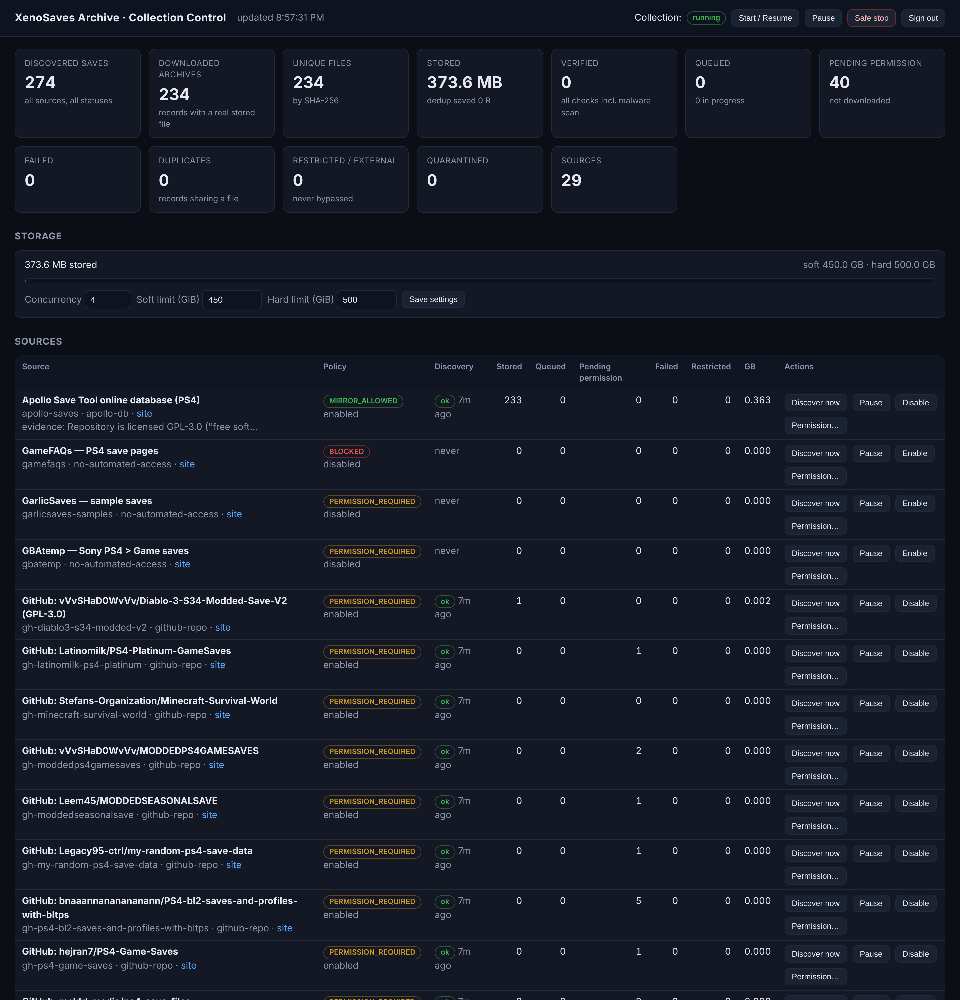

# Real end-to-end import — results

Run on 2026-11-06 in the build sandbox. **Setup:** PostgreSQL 16 (new, dedicated database), the production
S3/R2 storage driver pointed at an S3-compatible emulator (moto) because no Cloudflare credentials exist in the
sandbox, the real download worker with the SSRF guard **on** (private network disallowed), and live downloads
from the internet. The sandbox's network policy allows only GitHub, so only GitHub-hosted sources could be
collected here.



## Collection numbers (all from the live database — nothing estimated)

| Metric | Value |
|---|---|
| Sources registered | 29 (15 crawled live; the rest are catalogue entries awaiting permission or blocked) |
| Saves discovered | **274** |
| Permission-cleared (redistribution granted with evidence) | **234** (233 Apollo GPL-3.0 + 1 GPL-3.0 repo detected from its LICENSE file) |
| Downloaded and stored (object physically in storage) | **234** |
| Unique files (SHA-256) | **234** |
| Stored size | **391,721,852 bytes (373.6 MB)** |
| Source-published hash matches (git blob id) | **234 / 234** |
| Archive-safety verdict `ok` | 234 / 234 |
| Deep storage audit (every object re-downloaded and re-hashed) | **234 / 234 OK** |
| Fully `verified` (incl. malware scan) | **0** — ClamAV's signature database cannot be downloaded in this sandbox, so scans report `not_run`; the production compose file runs `clamd` |
| Permission pending (catalogued, **not** downloaded) | 40 (unlicensed GitHub repos) |
| Failed / restricted / quarantined | 0 / 0 / 0 |
| Distinct title IDs | 136 · size range 15.9 KB – 45.5 MB · mean 1.67 MB |
| Category suggestions (keyword heuristic, labelled as such) | 160 of 234 (100% Completion 62, New Game+ 23, Story Complete 22, Modded 19, …); 74 left uncategorised rather than guessed |
| Region | only 2 records state a region; the rest are `null` (CUSA IDs don't encode region and nothing was invented) |

**Against the 500 GB target:** 0.37 GB is stored, which is everything that can legally be mirrored from the sources
reachable today. See [SOURCES.md](SOURCES.md) for where the remaining ≈ 345 GB of reported saves live and
[PERMISSION-REQUESTS.md](PERMISSION-REQUESTS.md) for how to unlock them.

## Things the live run exercised (not just tests)

* **Restart recovery.** The worker was stopped mid-run; 3 records were left holding leases. When the leases
  expired, the next worker logged `requeued records from expired leases (recovered: 3)` and completed them.
* **A real bug, found and fixed.** Some saves' `PARAM.SFO` strings contain embedded NUL bytes, which PostgreSQL
  `jsonb` rejects. Affected records failed *after* upload and were retried. Fixed (NUL-safe JSON + SFO strings cut
  at the first NUL), regression tests added, records requeued and stored.
* **A false positive, reviewed and released.** *Dark Thrones* (`PS4/CUSA27656/00000002.zip`) was quarantined by the
  ZIP-bomb ratio rule: its `memory.dat` is a zero-padded save slot compressing ≈ 1009:1. Since nothing is ever
  extracted and decompressed bytes are capped, the ratio rule now applies only to entries over 512 MB. The owner
  **Re-check** action (new) deleted the quarantined copy, re-downloaded and re-inspected it, and it was stored.

## The 7-step proof for one save

### Record #5 — PS4/CUSA00207/00000001.zip

**1. Discovered on an external site**
source: Apollo Save Tool online database (PS4) | page: https://github.com/bucanero/apollo-saves/tree/master/PS4/CUSA00207 | discovered_at: 2026-11-06 20:49:22.785573+00
description (verbatim): Game completed, everything unlocked! Run in NG+2 (v1.09)

**2. Permitted archive download found**
file host: github | link: https://raw.githubusercontent.com/bucanero/apollo-saves/0b9dfb546b4ed1f1a0a2ce6f0b2ff9fce8fae7cc/PS4/CUSA00207/00000001.zip
redistribution: granted — source permission: Repository is licensed GPL-3.0 ("free software: you can redistribute it and/or modify it under the terms of the GNU GPL") — https://github.co

**3. Actual archive downloaded**
2026-11-06 20:50:44.924089+00  download-start: attempt 1 via github
2026-11-06 20:50:46.397038+00  downloaded: 2052180 bytes from raw.githubusercontent.com

**4. Verified and hashed**
sha256: dd3355169404b011a23ba8affc306a0e9aa70bb24bc094961cdf63e419991dac | size: 2052180 bytes | published hash: match (git-blob-sha1:1ad00de617c7fa9ab8f4b10d8fbca3c1250b7c7a) | archive safety: ok, entries 20 | malware scan: not_run — ClamAV signature database not installed (run freshclam) | verified flag: false

**5. Uploaded to object storage (S3 API / R2 driver)**
object key: blobs/sha256/dd/33/dd3355169404b011a23ba8affc306a0e9aa70bb24bc094961cdf63e419991dac
2026-11-06 20:50:46.57167+00  uploaded: blobs/sha256/dd/33/dd3355169404b011a23ba8affc306a0e9aa70bb24bc094961cdf63e419991dac (2052180 bytes)

**6. Metadata saved (public API view)**
{
 "id": 5,
 "game": "Bloodborne",
 "platform": "PS4",
 "title_id": "CUSA00207",
 "region": null,
 "category": "100% Completion",
 "category_source": "keyword-heuristic",
 "description": "Game completed, everything unlocked! Run in NG+2 (v1.09)",
 "original_author": null,
 "uploaded_by": "bucanero",
 "uploaded_by_source": "git-commit-author (person who committed the file; may be the maintainer)",
 "original_filename": "00000001.zip",
 "file_size": 2052180,
 "sha256": "dd3355169404b011a23ba8affc306a0e9aa70bb24bc094961cdf63e419991dac",
 "downloaded_at": "2026-11-06T20:50:46.573Z",
 "verified": false,
 "verification": {
  "integrity": "sha256 computed on download; storage upload checksum-verified",
  "published_hash": "match",
  "archive_safety": "ok",
  "archive_warnings": [],
  "malware_scan": "not_run"
 },
 "source": {
  "id": "apollo-saves",
  "name": "Apollo Save Tool online database (PS4)",
  "page_url": "https://github.com/bucanero/apollo-saves/tree/master/PS4/CUSA00207",
  "original_download_url": "https://raw.githubusercontent.com/bucanero/apollo-saves/0b9dfb546b4ed1f1a0a2ce6f0b2ff9fce8fae7cc/PS4/CUSA00207/00000001.zip",
  "license": "GPL-3.0-or-later"
 },
 "redistribution": {
  "status": "granted",
  "basis": "source permission: Repository is licensed GPL-3.0 (\"free software: you can redistribute it and/or modify it under the terms of the GNU GPL\") \u2014 https://github.com/bucanero/apollo-saves/blob/master/LICENSE and README \"License\" section."
 }
}

**7. Downloaded again through our own API**
without API key: HTTP 401
signed URL expires_at: 2026-11-06T21:02:09.106Z | filename: CUSA00207_Bloodborne_00000001.zip | X-Amz-Expires=300
bytes received: 2052180
sha256 of bytes from API: dd3355169404b011a23ba8affc306a0e9aa70bb24bc094961cdf63e419991dac
sha256 recorded in DB:    dd3355169404b011a23ba8affc306a0e9aa70bb24bc094961cdf63e419991dac
git blob id of bytes:     1ad00de617c7fa9ab8f4b10d8fbca3c1250b7c7a
git blob id on GitHub:    1ad00de617c7fa9ab8f4b10d8fbca3c1250b7c7a  (independent check against the source)
tampered signature: HTTP 200  ← emulator limitation: moto does not validate presigned-signature contents (real S3/R2 return 403); HMAC tamper rejection of the local driver is covered by tests
archive listing (7z l, no extraction):
2024-06-06 12:25:50 D....            0            0  savedata0
2024-06-06 12:25:50 D....            0            0  savedata0/sce_sys
2024-06-06 12:25:50 .....         2728          379  savedata0/sce_sys/param.sfo
2023-05-21 22:11:20 .....        32768           46  savedata0/sce_sys/sce_paramsfo1
2023-05-21 22:11:22 .....       116736          130  savedata0/sce_sys/sce_icon0png1
2023-05-21 22:11:22 .....        58994        59004  savedata0/sce_sys/icon0.png
2023-05-21 22:11:20 .....           96           82  savedata0/sce_sys/keystone
2024-06-06 12:11:16 .....      1310720       906806  savedata0/userdata0000

## Export of the live collection

`xsa export --out … --platform PS4 --chunk-gb 0.2` → **234 files, 391,721,852 bytes, 2 ZIP chunks in 6.8 s**; every
archive inside each chunk was re-read and SHA-256-checked before the chunk was marked complete. Layout:

```
catalog.json · catalog.csv · export-manifest.json
xenosaves-archive-part-0001.zip
  PS4/CUSA00207-Bloodborne/100-Completion-Game-completed-everything-unlocked-Run-in-NG-2-v1-09-5.zip
  PS4/CUSA00207-Bloodborne/metadata.json
  …
```

(API download names follow the same scheme: `CUSA00207_Bloodborne_100-Completion-…-5.zip`. The proof above
was captured before this naming change, so it shows the older `CUSA00207_Bloodborne_00000001.zip`.)

## Automated tests

`npm test` → **153 passed** (8 files): 144 unit tests, 8 pipeline integration tests (real PostgreSQL + local HTTP
server: 503-then-OK retry, mid-transfer disconnect resumed with HTTP Range, 404 dead link, HTML login page →
RESTRICTED, password ZIP → RESTRICTED, zip-slip and executable → QUARANTINED, oversize → FAILED, exact-duplicate and
same-link dedup with credits preserved, permission-pending never fetched, API key + signed link download, chunked
export with checksum verification and resume, takedown with object deletion, lease recovery) and 1 S3-driver test
(single + multipart upload, read-back verification rejecting a wrong hash, presigned GET, private access, list, delete).

## Not done / not verifiable here (stated plainly)

* **Not deployed anywhere.** No server, R2 bucket or DNS was created — that needs your accounts and approval
  ([DEPLOY.md](DEPLOY.md)).
* **Real Cloudflare R2** was not contacted (no credentials). The driver uses the standard S3 API R2 implements, and was
  tested against an S3-compatible emulator.
* **MediaFire, MEGA, Google Drive, Dropbox, OneDrive** resolvers are unit-tested against page/URL fixtures only — those
  hosts are unreachable from the sandbox. Smoke-test them from the server before relying on them.
* **The Tech Game, PlayerSquared and other forums** were not contacted (unreachable here, and member-gated or
  without recorded permission). Their saves arrive through your scraper exports once permission is recorded.
* **Malware scanning** did not run (no signature DB here); records therefore show `verified: false`, and the demo API
  was started with `SERVE_UNSCANNED_FILES=true`. Production default is `false`.
